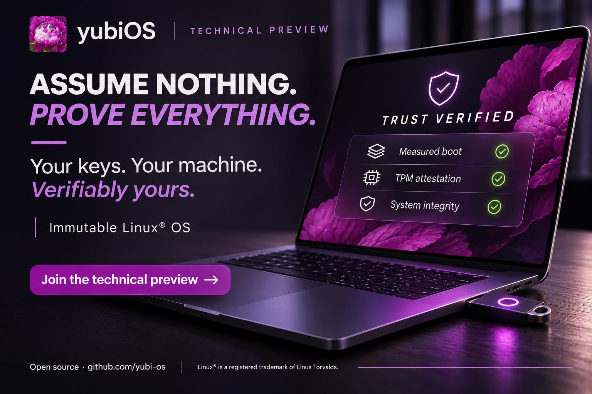
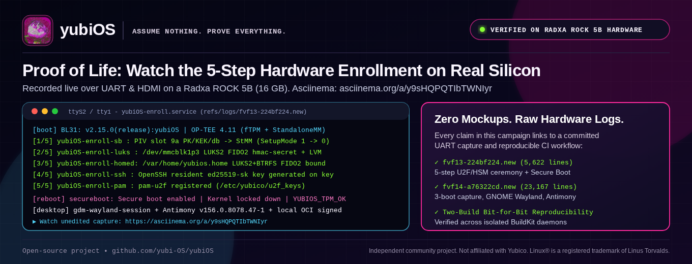
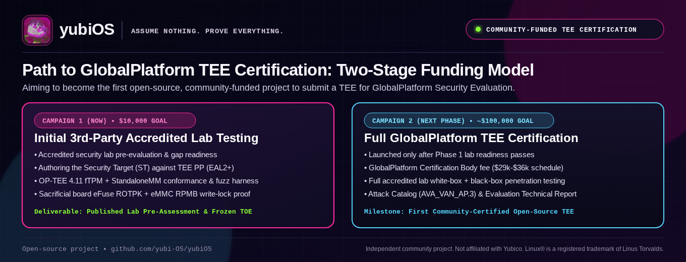
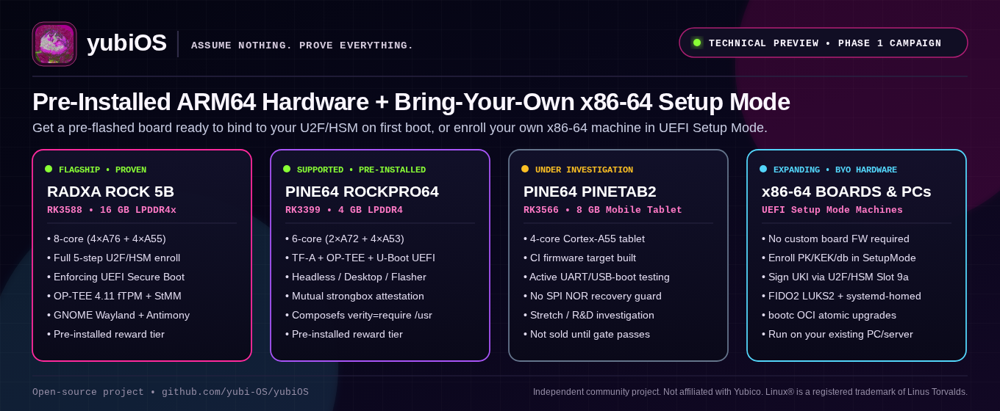
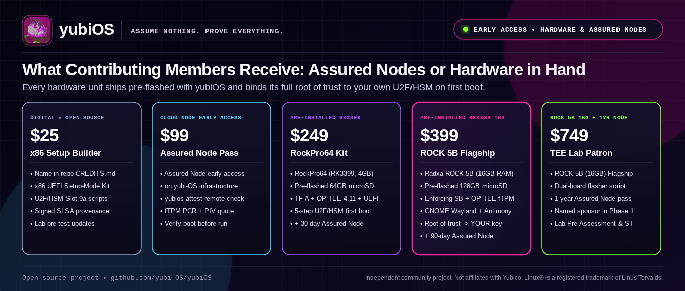
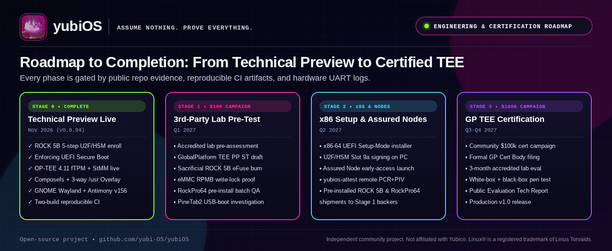

# GoFundMe Campaign Draft: yubiOS

> **GoFundMe Dashboard Setup Fields (Copy-Paste into GoFundMe Creator Flow)**
> - **Title (58/60 chars):** `Certify yubiOS: Open-Source U2F/HSM Linux & ARM64 TEE Lab`
> - **Category:** `Business / Technology & Open-Source Community Infrastructure`
> - **Location / Currency:** `Los Angeles, CA (90001)` · `USD ($)`
> - **Who are you fundraising for?** `Yourself` (yubi-OS Open-Source Project / Accredited Lab Testing & Hardware Provisioning)
> - **Primary Cover Image:** `https://raw.githubusercontent.com/yubi-OS/assets/main/ads/yubiOS_Technical_Preview.jpg` (`ads/yubiOS_Technical_Preview.jpg`)
> - **Proof-of-Life Asciinema:** `https://asciinema.org/a/y9sHQPQTIbTWNIyr`
> - **Initial Fundraising Goal (Phase 1):** `$10,000 USD` (Flexible Funding; precedes Phase 2 `~$100,000` full GlobalPlatform TEE certification campaign)

---

## Cover Image

---

## GoFundMe Story Body (Copy-Paste Ready)

### Assume Nothing. Prove Everything. Put the Owner Back in the Linux Trust Chain.

Modern computers ask you to trust a black box. Even when you run Linux, your boot chain, firmware, and disk encryption keys are typically anchored to an OEM-controlled Trusted Platform Module (TPM) and factory-enrolled keys you didn't generate and can't inspect.

We built **yubiOS** ([github.com/yubi-OS/yubiOS](https://github.com/yubi-OS/yubiOS)) so the human owner holds the cryptographic root of trust in their own hand.

**yubiOS** is an open-source (`LGPL-2.1`), `bootc`-based immutable Linux® operating system where your personal **U2F/HSM hardware token** (YubiKey 5 series as the reference device) authorizes every security boundary:

1. **UEFI Secure Boot & Kernel Signing:** Your U2F/HSM PIV slot `9a` (`RSA-2048` via `systemd-sbsign` + PKCS#11) mints your own Platform Key (`PK`), Key Exchange Key (`KEK`), and Signature Database (`db`), and signs `systemd-boot` and the Type2 Unified Kernel Image (UKI).
2. **Full-Disk Decryption (`LUKS2` + LVM):** Your U2F/HSM FIDO2 `hmac-secret` credential (`systemd-cryptenroll`, requiring both PIN and physical touch) decrypts the root partition (`p3`) and mounts a read-only, SHA-512-verified `composefs` (`verity=require`) `/usr` with a 3-way A/B OverlayFS.
3. **Encrypted User Homes (`systemd-homed`):** Your `/var/home/<user>.home` LUKS2 + BTRFS volume stays encrypted at rest until your physical U2F/HSM is present.
4. **Hardware-Resident SSH & Sudo (`ed25519-sk` + `pam-u2f`):** Your SSH private key lives permanently inside your U2F/HSM hardware, and every `sudo` command requires a physical tap on your token.
5. **Provenance-Gated Browsing (Antimony v156):** Ships with the **GNOME Wayland desktop** and our checksum-pinned **Antimony Browser (`v156.0.8078.47-1`)**, featuring engine-layer C2PA content provenance inspection (`chrome://settings/provenance`).

---

### Proof of Life: Watch yubiOS Enrolling & Booting on Real Hardware Today

yubiOS isn't a paper concept. **Version `v0.8.94` is live, reproducible, and running on real ARM64 silicon today.**

👉 **Watch our unedited Radxa ROCK 5B hardware enrollment & Secure Boot demo on Asciinema:**  
**https://asciinema.org/a/y9sHQPQTIbTWNIyr**

Every step in that recording is backed by raw serial UART logs committed to our public repository ([`refs/logs/fvf13-224bf224.new`](https://github.com/yubi-OS/yubiOS/blob/main/refs/logs/fvf13-224bf224.new) and [`refs/logs/fvf14-a76322cd.new`](https://github.com/yubi-OS/yubiOS/blob/main/refs/logs/fvf14-a76322cd.new)):
- **First Boot in `SetupMode=1`:** `U-Boot 2027.01-rc2` + `ARM Trusted Firmware-A (BL31 v2.15.0)` + `OP-TEE 4.11` (`fTPM` + `StandaloneMM`) boot `composefs` (`verity=require`) and display our 5-step enrollment wizard simultaneously on **HDMI (`/dev/tty1`)** and **serial UART (`/dev/ttyS2`)**.
- **5-Step Physical U2F/HSM Ceremony:** On-device minting of `PK`/`KEK`/`db` from U2F/HSM PIV slot `9a` into OP-TEE `StandaloneMM` (`SetupMode: 1 -> 0`), UKI re-signing and local OCI commit (`ADR-034`), FIDO2 `hmac-secret` LUKS2 formatting, `systemd-homed` creation, `ed25519-sk` resident SSH key generation, and `pam-u2f` registration.
- **Enforcing Reboot to GNOME Desktop:** Subsequent reboots verify the PIV-9a-signed UKI with `secureboot: Secure boot enabled`, `Kernel is locked down from EFI Secure Boot mode`, and `YUBIOS_TPM_OK`, logging straight into GNOME Wayland and Antimony v156.

---

### Why We Are Raising $10,000 Now (And Our Two-Campaign Path to GlobalPlatform TEE Certification)

On ARM64 boards like the **Radxa ROCK 5B (`rk3588`)** and **Pine64 RockPro64 (`rk3399`)**, yubiOS owns the open-source firmware stack below the kernel: **TF-A (`BL31 v2.15.0`)** + **OP-TEE `4.11`** (running both an open **`fTPM`** and **EDK2 `StandaloneMM`** for authenticated UEFI Secure Boot variables).

Our goal is to have our open-source **Trusted Execution Environment (TEE)** formally certified by **GlobalPlatform** under the **GlobalPlatform TEE Protection Profile (`TEE PP`, Common Criteria `EAL2+` augmented with `AVA_VAN_AP.3`)**.

No open-source, community-funded project has ever taken an open ARM64 TEE through GlobalPlatform certification. Because formal certification costs roughly **$100,000** in combined GlobalPlatform Certification Body fees (`$29,000-$36,000`) and accredited security laboratory evaluation fees, we are splitting the effort into two transparent phases:

1. **Campaign 1 (This Campaign - $10,000 Goal):** Covers **initial third-party accredited security laboratory pre-testing**, formal **Security Target (ST)** authoring against the GlobalPlatform `TEE PP`, OP-TEE conformance and fault-injection harness validation, and sacrificial hardware testing for **OTP eFuse ROTPK burning (`OMN-45`)** and **eMMC RPMB write-lock persistence (`OMN-46`)**.
2. **Campaign 2 (Next Phase - ~$100,000 Goal):** Once this `$10,000` initial lab testing succeeds and we publish the lab's pre-assessment report in our open repository, we will launch a second campaign (`~$100,000`) inviting the community to crowd-certify their own product. That second phase will fund the formal GlobalPlatform Certification Body filing and the 3-month accredited laboratory white-box and black-box penetration evaluation.

---

### Hardware Availability: Pre-Installed ARM64 Boards & x86-64 Setup-Mode Support

Alongside our lab testing, we are making yubiOS available across four hardware paths:

- **Pre-Installed on Radxa ROCK 5B (`rk3588`, 16 GB RAM):** Our flagship 8-core ARM64 desktop and server board, shipped pre-flashed with yubiOS `v0.8.94+` and our `TF-A` + `OP-TEE 4.11` + `U-Boot UEFI` stack in `SetupMode=1` so it binds its entire root of trust to **your** U2F/HSM on first power-on.
- **Pre-Installed on Pine64 RockPro64 (`rk3399`, 4 GB RAM):** Our proven 6-core ARM64 node for headless infrastructure, remote attestation, and local flashing.
- **Pine64 PineTab2 (`rk3566`) Investigation:** We already build a `:firmware-pinetab2-rk3566` target in CI, and we are actively investigating safe UART/USB-boot installer and recovery flows on PineTab2 hardware (`OMN-167`). We keep it marked *Under Investigation* until its non-destructive boot gate is proven.
- **Expanding to x86-64 Boards & PCs (UEFI Setup Mode):** For users without our ARM64 boards or firmware, we are shipping an **x86-64 UEFI Setup-Mode Enrollment Kit**. Any x86-64 motherboard, laptop, or server that allows enrolling custom keys in UEFI Setup Mode (`SetupMode=1`) can use a U2F/HSM (`PIV slot 9a` + PKCS#11) to sign `systemd-boot` and the yubiOS Type2 UKI, plus FIDO2 `hmac-secret` to decrypt `LUKS2` and `systemd-homed`.

---

### What Contributing Members Receive

Every contributor to this `$10,000` Phase 1 campaign helps launch open-source TEE lab testing and receives concrete access to the yubiOS ecosystem:

- **$25+ (Open-Source x86-64 Setup-Mode Supporter):** Permanent credit in `CREDITS.md` + early access to the **x86-64 UEFI Setup-Mode U2F/HSM Enrollment Kit** and signed SLSA provenance bundles.
- **$99+ (Early Access: Assured Infrastructure Node):** Receive a **60-day Early-Access Pass to an Assured Node** on yubi-OS infrastructure. Before running any workload, you verify the node remotely with `yubios-attest` (which checks the live OP-TEE `fTPM` PCR `0..7, 11` quote paired with a hardware U2F/HSM PIV signature).
- **$249+ (Pre-Installed Pine64 RockPro64 RK3399 Kit + Assured Node):** Receive a **Pine64 RockPro64 (`rk3399`, 4 GB)** pre-installed with yubiOS on a `64 GB` industrial microSD card, ready to bind its full root of trust to your own U2F/HSM on first boot, plus **30 days of Assured Node access**.
- **$399+ (Pre-Installed Radxa ROCK 5B RK3588 16 GB Flagship Kit + Assured Node):** Receive a **Radxa ROCK 5B (`rk3588`, 16 GB RAM)** pre-installed with yubiOS `v0.8.94+` on a `128 GB` industrial microSD card (with GNOME Wayland, Antimony Browser v156, `OP-TEE 4.11` `fTPM` + `StandaloneMM`, heatsink/fan, and USB-C PD PSU), ready to bind Secure Boot, LUKS2, `systemd-homed`, `ed25519-sk` SSH, and `pam-u2f` to your own U2F/HSM on first boot, plus **90 days of Assured Node access**.
- **$749+ (TEE Lab Verification Patron):** Full **Pre-Installed Radxa ROCK 5B (16 GB) Flagship Kit** + **1-Year Priority Assured Node Pass** + named credit as a **Lab Verification Co-Sponsor** on our Phase 1 Accredited Lab Pre-Assessment Report and GlobalPlatform Security Target (`ST`) filing.

---

### Line-Item Breakdown of the $10,000 Phase 1 Goal

| Allocation Category | Amount (USD) | Concrete Deliverable Published to `yubi-OS/yubiOS` |
|---|---:|---|
| **1. Accredited Lab Pre-Assessment & TOE Review** | `$4,500` | Third-party accredited security laboratory pre-evaluation of `TF-A BL31 v2.15` + `OP-TEE 4.11` (`fTPM` + `StandaloneMM`) and attack-surface gap report. |
| **2. GlobalPlatform `TEE PP` Security Target (ST) & Harness** | `$2,500` | Formal Common Criteria `EAL2+` / `AVA_VAN_AP.3` Security Target document + automated GlobalPlatform TEE conformance and fault-injection test suite in CI. |
| **3. Sacrificial Hardware Fuse (`OMN-45`) & RPMB (`OMN-46`) Testing** | `$2,000` | Sacrificial Radxa ROCK 5B boards + eMMC modules to prove irreversible OTP eFuse ROTPK burning, eMMC RPMB write-locking, and PineTab2 UART/USB-boot testing (`OMN-167`). |
| **4. Payment Processing & Fulfillment Reserve** | `$1,000` | Covers payment processing fees (`2.9% + $0.30`) and packaging/flashing verification fixtures. |
| **Total Phase 1 Goal** | **`$10,000`** | **Opens the Phase 2 (~$100,000) Full GlobalPlatform TEE Certification Campaign.** |

---

### Roadmap to Completion

1. **Nov 2026 (Done):** `yubiOS v0.8.94` Technical Preview live; Radxa ROCK 5B 5-step physical U2F/HSM enrollment, enforcing UEFI Secure Boot, `composefs` + 3-way `/usr` OverlayFS, GNOME Wayland, and Antimony v156 verified in public UART logs (`fvf13`, `fvf14`) and [Asciinema](https://asciinema.org/a/y9sHQPQTIbTWNIyr).
2. **Q1 2027 (Stage 1 - $10k Lab Pre-Test):** Contract accredited TEE lab for pre-assessment; author GlobalPlatform `TEE PP` Security Target; complete sacrificial ROCK 5B eFuse ROTPK burn (`OMN-45`), eMMC RPMB persistence proof (`OMN-46`), and PineTab2 boot investigation (`OMN-167`).
3. **Q2 2027 (Stage 2 - x86 Setup Mode & Assured Nodes):** Ship the x86-64 UEFI Setup-Mode U2F/HSM Enrollment Kit (`March 2027`); onboard contributors to remotely attested Assured Nodes (`April 2027`); publish Phase 1 Lab Pre-Assessment Report.
4. **Q3-Q4 2027 (Stage 3 - Hardware Shipments & ~$100k Certification Campaign):** Ship pre-installed RockPro64 (`June 2027`) and Radxa ROCK 5B 16 GB (`July 2027`) kits to contributors; launch Campaign 2 (`~$100,000`) to complete formal 3-month GlobalPlatform TEE Certification.

---

## GoFundMe Donor Update Templates (Ready to Post)

### Update #1: Launch Day & Live Hardware Proof
> **Title:** yubiOS Phase 1 Is Live: Watch Our Radxa ROCK 5B Hardware Enrollment!  
> **Body:**  
> Thank you to everyone backing Day 1 of our `$10,000` Phase 1 Accredited TEE Lab Testing drive!  
> If you haven't seen the hardware ceremony in action yet, watch our unedited Radxa ROCK 5B (`rk3588`, 16 GB) 5-step U2F/HSM enrollment and enforcing UEFI Secure Boot reboot here: https://asciinema.org/a/y9sHQPQTIbTWNIyr (raw UART logs `fvf13-224bf224.new` and `fvf14-a76322cd.new` are in the repo at https://github.com/yubi-OS/yubiOS).  
> Every dollar in this `$10,000` phase goes straight toward accredited third-party security laboratory pre-testing, authoring our GlobalPlatform `TEE PP` (`EAL2+` / `AVA_VAN_AP.3`) Security Target, and closing our sacrificial eFuse ROTPK (`OMN-45`) and eMMC RPMB (`OMN-46`) hardware gates.

### Update #2: 50% Milestone ($5,000 Reached) - Lab Scoping & x86-64 Setup Mode Preview
> **Title:** 50% Funded ($5,000): Accredited Lab Scoping & x86-64 UEFI Setup-Mode Preview  
> **Body:**  
> We just crossed `$5,000` (`50%` of our Phase 1 goal)!  
> This week we finalized the Target of Evaluation (TOE) boundary document for our ARM64 `TF-A BL31 v2.15` + `OP-TEE 4.11` (`fTPM` + `StandaloneMM`) stack and packaged the first preview of our **x86-64 UEFI Setup-Mode Enrollment Kit** so users on standard PCs can enroll U2F/HSM PIV Slot `9a` `PK`/`KEK`/`db` certificates without custom board firmware. Share the campaign with a fellow Linux or security engineer to help us close the remaining `$5,000`!

---

## Independence & Trademark Notice

yubiOS is an independent open-source community project (`LGPL-2.1`). It is not affiliated with, sponsored by, or endorsed by Yubico AB, Radxa, Pine64, or GlobalPlatform, Inc. YubiKey and Yubico are registered trademarks of Yubico AB. Linux® is the registered trademark of Linus Torvalds in the U.S. and other countries.
