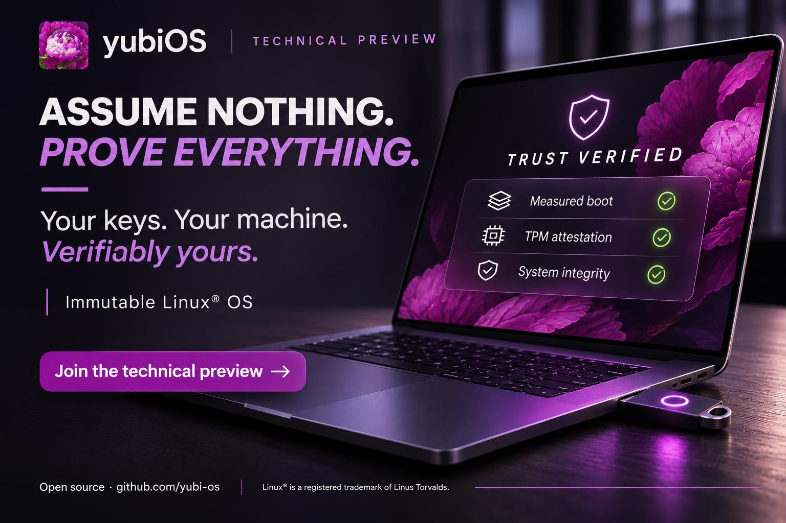
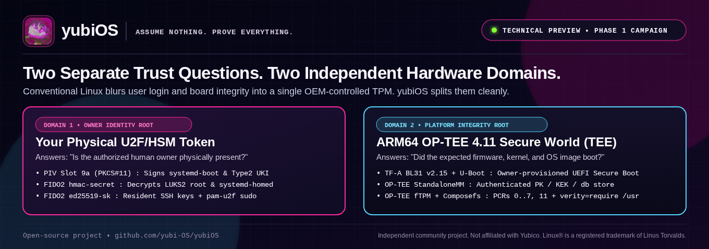
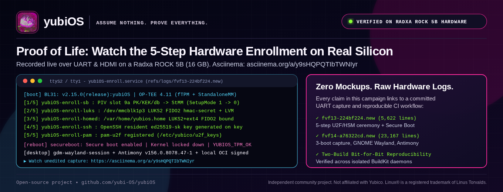
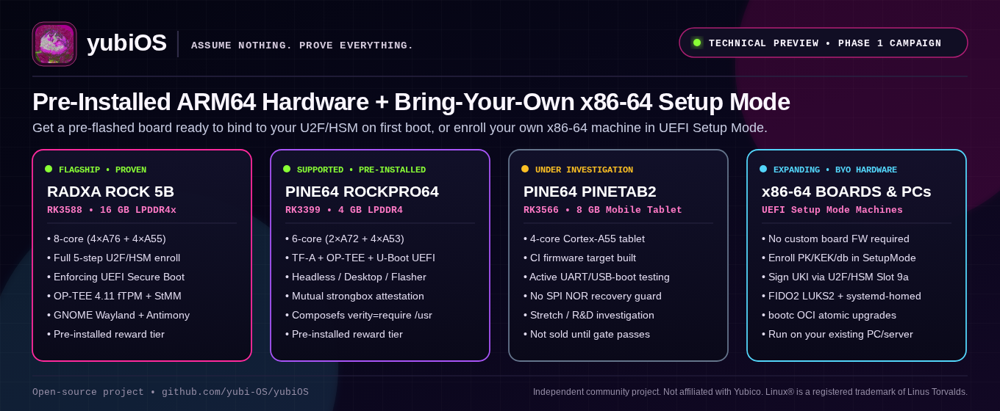
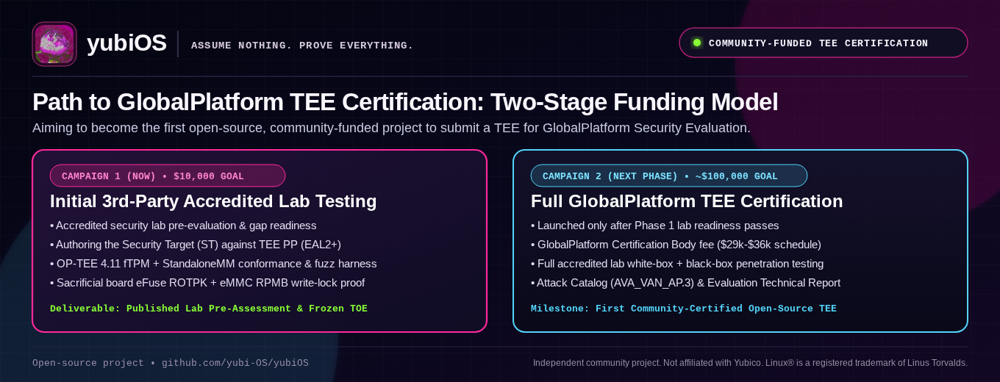
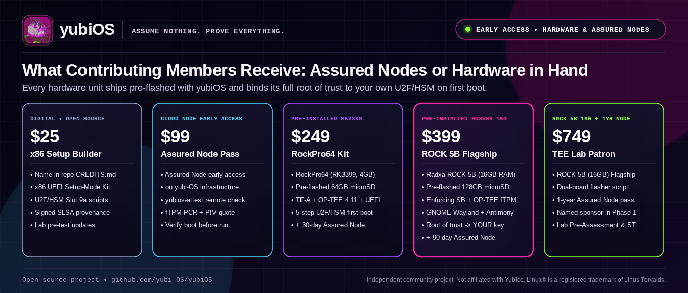
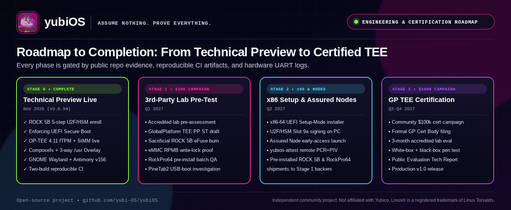

# Kickstarter Campaign Draft: yubiOS

> **Editor Setup Summary (Copy-Paste into Kickstarter Project Editor)**
> - **Title (55/60 chars):** `yubiOS: FIDO2-First Immutable Linux OS & Open ARM64 TEE`
> - **Subtitle (127/135 chars):** `Pre-installed on ROCK 5B & RockPro64, or run on x86 Setup Mode. Your U2F/HSM signs boot, decrypts disk, and attests your node.`
> - **Category:** `Technology` -> `Hardware` (Secondary tag: `Open-Source Software`)
> - **Project Location:** `Los Angeles, CA`
> - **Primary Campaign Image:** `https://raw.githubusercontent.com/yubi-OS/assets/main/ads/yubiOS_Technical_Preview.jpg` (`ads/yubiOS_Technical_Preview.jpg`)
> - **Primary Campaign Video (90.0s 1080p MP4):** [`assets/yubios-kickstarter-hero.mp4`](assets/yubios-kickstarter-hero.mp4) (`https://raw.githubusercontent.com/yubi-OS/assets/main/campaigns/assets/yubios-kickstarter-hero.mp4`)
> - **Proof-of-Life Video / Asciicast:** `https://asciinema.org/a/y9sHQPQTIbTWNIyr`
> - **Funding Goal (Phase 1 All-or-Nothing):** `$10,000 USD`
> - **Campaign Duration:** `30 Days`

---

## Hero Section & Opening Hook

**Assume Nothing. Prove Everything. Your keys. Your machine. Verifiably yours.**

**yubiOS** is an open-source, FIDO2-first, `bootc`-delivered immutable Linux® operating system where a physical **U2F/HSM security key** (YubiKey 5 series as our reference device) sits in the owner's hand and authorizes every trust boundary:

- **UEFI Secure Boot & Unified Kernel Image (UKI) Signing:** Your U2F/HSM PIV slot `9a` (`RSA-2048` via `systemd-sbsign` + PKCS#11) signs `systemd-boot` and the Type2 UKI directly on the machine.
- **Full-Disk Encryption (`LUKS2` + LVM):** Your U2F/HSM FIDO2 `hmac-secret` credential (`systemd-cryptenroll`, PIN + physical touch) decrypts the root volume without relying on an opaque OEM TPM to silently release disk keys on boot.
- **Encrypted User Homes (`systemd-homed`):** Per-user LUKS2 + ext4 home directories (`/var/home/<user>.home`) mount only when your physical token is tapped.
- **Hardware-Resident SSH & Local Privilege (`sudo`):** Discoverable `ed25519-sk` SSH private keys never leave your U2F/HSM hardware, and `pam-u2f` (`>= 1.3.1`) gates local login and `sudo` escalation with a physical touch.

With this campaign, we are making **yubiOS available pre-installed on the Radxa ROCK 5B (`rk3588`) and Pine64 RockPro64 (`rk3399`)**, expanding our **U2F/HSM Secure Boot key-signing tooling to x86-64 boards and PCs** that support UEFI Setup Mode, providing backers with **early access to remotely attested Assured Nodes** on our infrastructure, and raising **$10,000 for Phase 1 third-party accredited security laboratory testing** as our first step toward **GlobalPlatform TEE Certification**.

---

## Why We Built yubiOS: Open Firmware, Pinned Supply Chain, Zero Trust in the Author

Most operating systems ask you to trust an invisible chain of third parties: closed OEM firmware, factory-enrolled Secure Boot keys you didn't generate, and an onboard TPM that releases your disk decryption keys automatically before a human ever touches the keyboard.

yubiOS is built on a structural rule: **nothing on the system asks you to trust an author, human or machine. Every layer is cryptographically verified before it runs, and owner authority lives in a physical token you hold.**

- **Immutable `/usr` via `composefs` (`verity=require`):** The operating system root is mounted read-only from a SHA-512 digest embedded inside the U2F/HSM-signed Type2 UKI `.cmdline`, paired with a 3-way A/B `/usr` OverlayFS (`usr_a`, `usr_b`) on LVM for atomic day-2 package layering and instant rollback.
- **Automatic Local OCI Re-Signing (`ADR-034`):** When you update packages or kernels on the machine, `yubiOS-uki-resign` rebuilds the UKI, prompts for your physical U2F/HSM touch to sign it via PIV slot `9a`, commits the verified tree to the on-device OCI store (`oci:/var/lib/yubiOS/oci:yubios-local:latest`), and updates the EFI System Partition.
- **Digest-Pinned & Two-Build Reproducible CI (`PINNED.md` + `yubiOS.rego`):** Every base container, GitHub Action, and firmware tree commit is SHA-pinned in `PINNED.md` and enforced before build execution by our OPA/Rego policy (`yubiOS.rego`) inside rootless BuildKit (`ADR-014`). Our CI builds every release twice across isolated BuildKit daemons at `SOURCE_DATE_EPOCH` and verifies bit-for-bit identical OCI digests, attached with SLSA v1.0 provenance and SPDX SBOM attestations.

---

## Two Separate Trust Questions. Two Independent Hardware Domains.

Conventional systems lump two completely different security questions into one motherboard chip. yubiOS separates them into two distinct hardware domains that work in parallel:

#### Why 2 Trust Domains?

- **Domain 1: Owner Identity Root (Your Physical U2F/HSM Token)** - Answers: *"Is the authorized human owner physically present?"* Your removable U2F/HSM holds the un-exportable private keys for UEFI Secure Boot signing (PIV slot `9a`), LUKS2 disk decryption (FIDO2 `hmac-secret`), `systemd-homed` login, resident `ed25519-sk` SSH authentication, and `pam-u2f` `sudo` approval. Unplug the key and walk away: your signing authority and credentials leave the room with you.
- **Domain 2: Platform Integrity Root (ARM64 OP-TEE 4.11 Secure World)** - Answers: *"Did the expected firmware, kernel, and OS image boot?"* On our ARM64 boards, ARM Trusted Firmware-A (`BL31 v2.15.0`) boots **OP-TEE `4.11`** in TrustZone (`optee@30000000`, `36,864 KiB` `no-map` reserved memory), hosting both an **`fTPM`** (`PCRs 0..7, 11` measured boot + Linux IMA runtime integrity) and **EDK2 `StandaloneMM`** (an isolated secure-world variable store holding your U2F/HSM-minted `PK`, `KEK`, and `db` Secure Boot certificates).

By pairing your U2F/HSM with OP-TEE through our **`yubios-attest`** mutual strongbox attestation daemon, a local or remote verifier checks both proofs at once: the platform booted the exact signed image measured in `fTPM` PCRs, and the physical U2F/HSM owner signed the attestation binding.

---

## Proof of Life: Live 5-Step Hardware Enrollment on Radxa ROCK 5B

We aren't launching this campaign with slide-deck promises or concept renders. **yubiOS `v0.8.94` is already booting, enrolling physical U2F/HSM tokens, locking down UEFI Secure Boot, and launching the GNOME Wayland desktop on real Radxa ROCK 5B (`rk3588`, 16 GB RAM) silicon.**

👉 **[Watch the Unedited Live Hardware Enrollment Asciicast (`asciinema.org/a/y9sHQPQTIbTWNIyr`)](https://asciinema.org/a/y9sHQPQTIbTWNIyr)**

Every line of that recording is backed by raw UART serial captures committed directly to our repository ([`refs/logs/fvf13-224bf224.new`](https://github.com/yubi-OS/yubiOS/blob/main/refs/logs/fvf13-224bf224.new) at `5,622` lines and [`refs/logs/fvf14-a76322cd.new`](https://github.com/yubi-OS/yubiOS/blob/main/refs/logs/fvf14-a76322cd.new) at `23,167` lines):

| Enrollment Step | What Happens on First Boot (`yubiOS-enroll.service`) | Hardware Proof (`fvf13` & `fvf14`) |
|---|---|---|
| **Boot & Dual Console** | `U-Boot 2027.01-rc2` + `TF-A BL31 v2.15.0` + `OP-TEE 4.11` (`fTPM` + `StandaloneMM`) boot `composefs` (`verity=require`) and mirror the enrollment wizard across both **HDMI (`/dev/tty1`)** and **UART (`/dev/ttyS2`)**. | `fvf13 L0068-L1000` (`YUBIOS_TPM_OK`, `SetupMode=1`) |
| **Step 1/5: Secure Boot (`enroll-sb.sh`)** | Mints self-signed `PK`, `KEK`, and `db` from your U2F/HSM PIV slot `9a`, writes them into OP-TEE `StandaloneMM` (`efi-updatevar`, flipping `SetupMode: 1 -> 0`), re-signs `systemd-bootaa64.efi`, `BOOTAA64.EFI`, and the Type2 UKI, and commits to the local OCI store. | `fvf13 L1835-L1907` (`sbverify` PASS, local OCI committed) |
| **Step 2/5: Disk Encryption (`enroll-luks.sh`)** | Claims remaining disk space (`p3`), formats as `LUKS2` (`crypt`), initializes LVM VG `lvm` (`usr_a 1%`, `usr_b 1%`, `yubios-root 96%`), prints your offline recovery key, and binds decryption to your U2F/HSM FIDO2 `hmac-secret` (PIN + touch). | `fvf13 L1908-L2120` |
| **Step 3/5: User Home (`enroll-homed.sh`)** | Creates your encrypted LUKS2 + ext4 home directory (`/var/home/yubios.home`) gated by your U2F/HSM FIDO2 credential via `systemd-homed`. | `fvf12 L4415-L4529` |
| **Step 4/5: Resident SSH (`enroll-ssh.sh`)** | Generates a hardware-resident `ed25519-sk` OpenSSH key inside the U2F/HSM (`verify-required`, touch on every SSH connection). | `fvf13 L2210-L2260` |
| **Step 5/5: PAM U2F (`enroll-pam.sh`)** | Registers your U2F/HSM in `/etc/yubico/u2f_keys` for local login and `sudo` confirmation. | `fvf13 L2261-L2310` |
| **Enforcing Reboot & Desktop** | Board reboots with `secureboot: Secure boot enabled` and `Kernel is locked down from EFI Secure Boot mode`, decrypts LUKS2 via FIDO2 tap, and logs into the **GNOME Wayland desktop** with the **Antimony Browser v156**. | `fvf13 L2909`, `fvf14 L0001-L23167` |

#### Hardware Enrollment FAQ

> **Do I need a serial UART cable to enroll my U2F/HSM?**  
> No. Our built-in PTY multiplexer (`YUBIOS_DUAL_CONSOLE_MUX`) mirrors the entire 5-step enrollment wizard simultaneously to your **HDMI monitor (`/dev/tty1`)** with a standard USB keyboard and to the **serial UART console (`/dev/ttyS2`)** for headless operators.

> **What if I lose or damage my primary U2F/HSM?**  
> Step 2/5 generates a high-entropy offline recovery key during provisioning, and `yubiOS-enroll` supports enrolling a backup U2F/HSM token into secondary LUKS2, `systemd-homed`, and `pam-u2f` slots so you never get locked out of your own hardware.

---

## Pre-Installed ARM64 Boards + x86-64 Setup-Mode Expansion

### 1. Pre-Installed Flagship: Radxa ROCK 5B (`rk3588`, 16 GB RAM)
Our primary desktop and edge-server board. Powered by the 8-core Rockchip `RK3588` (`4× Cortex-A76` + `4× Cortex-A55`) with `16 GB LPDDR4x` RAM, dual HDMI 2.1 (`8K@60Hz` / `4K@120Hz`), 2.5 Gigabit Ethernet, and M.2 NVMe support. Ships pre-installed with yubiOS `v0.8.94+` on a high-endurance `128 GB` microSD card, including our custom `TF-A v2.15.0` + `OP-TEE 4.11` (`fTPM` + `StandaloneMM`) + `U-Boot UEFI` stack. Plug in your monitor, keyboard, and U2F/HSM, power on, and complete the 5-step ceremony in under 5 minutes to bind the entire board to your key.

### 2. Pre-Installed Sovereign Node: Pine64 RockPro64 (`rk3399`, 4 GB RAM)
Our battle-tested 6-core (`2× Cortex-A72` + `4× Cortex-A53`) ARM64 workhorse, ideal as a home-lab server, remote attestation anchor, or dedicated yubiOS flashing station. Ships pre-flashed on a `64 GB` microSD card with the full yubiOS immutable OS, `OP-TEE 4.11` (`fTPM` + `StandaloneMM`), and first-boot U2F/HSM enrollment wizard.

### 3. Mobile Linux Tablet R&D: Pine64 PineTab2 (`rk3566`) - *Under Investigation*
We already build a dedicated firmware container target (`:firmware-pinetab2-rk3566`) for the Pine64 PineTab2 (`rk3566`) in `ci_firmware-rk.yml`. Because our test PineTab2 hardware lacks a populated SPI NOR flash for maskrom fallback and its USB-C port requires specialized UART/SD boot sequencing (`OMN-167`), we are actively investigating safe installer and recovery flows before offering pre-installed PineTab2 units. We believe in radical engineering honesty: we won't take orders for pre-installed PineTab2 hardware until our non-destructive boot and recovery gate is 100% proven in public logs.

### 4. Expanding to x86-64 Boards & PCs (UEFI Setup Mode)
You don't need to buy a new ARM64 board to benefit from yubiOS's owner-held trust chain. We are expanding our installer and key-enrollment toolkit to **x86-64 motherboards, mini-PCs, and laptops that support enrolling custom keys in UEFI Setup Mode (`SetupMode=1`)**:
- **How it works on x86-64:** Clear your motherboard's factory UEFI keys into **Setup Mode**, boot yubiOS (`linux/amd64` OCI image), and run `yubiOS-enroll-sb`. Your U2F/HSM PIV slot `9a` generates and signs your own Platform Key (`PK`), Key Exchange Key (`KEK`), and Signature Database (`db`), enrolling them directly into your x86 UEFI firmware variables and signing `systemd-bootx64.efi` and the Type2 UKI via PKCS#11.
- **Honest platform boundary:** On x86-64, vendor BIOS/UEFI firmware below the UKI remains OEM-controlled (unlike our ARM64 TF-A + OP-TEE stack), so our CHIPSEC first-boot portable service (`ADR-024`) inspects SPI flash write-locks and SMM isolation while your U2F/HSM takes full ownership of UEFI Secure Boot signing, LUKS2 FIDO2 decryption, `systemd-homed`, SSH, and PAM above the UEFI boundary.

#### Platform & x86-64 FAQ

> **Can I install yubiOS on my own Radxa ROCK 5B, RockPro64, or x86-64 machine right now?**  
> Yes. The multi-arch OCI image (`docker.io/0mniteck/yubios:latest` for `linux/amd64` and `linux/arm64`) and the automated SD flasher (`scripts/flash-device-e2e.sh`) are open-source and live today at [github.com/yubi-OS/yubiOS](https://github.com/yubi-OS/yubiOS). Backing a hardware tier gets you a turn-key, factory-tested board pre-flashed and ready for first-boot U2F/HSM binding while directly funding our third-party TEE lab testing.

> **Does a U2F/HSM come in the box, or can I use my existing YubiKey 5?**  
> You can use any existing **YubiKey 5 Series** (firmware `>= 5.2.3`, which supports both PIV slot `9a` RSA-2048 signing and FIDO2 `hmac-secret` / `ed25519-sk`). Because a core rule of yubiOS is that **no one else ever touches your root key**, you generate or enroll your keys yourself during the 5-step first-boot wizard on your own desk.

---

## Built-In Desktop & Provenance-Gated Browser: Antimony v156

Booting into yubiOS on the Radxa ROCK 5B brings up a clean, hardware-accelerated **GNOME Wayland desktop** featuring our **Aurora Ridge 4K** wallpaper and **Antimony Browser (`v156.0.8078.47-1`)** pre-installed out of the box:

- **Engine-Layer C2PA Provenance Gating:** Built from our open patch series at [`yubi-OS/chromium-provenance`](https://github.com/yubi-OS/chromium-provenance), Antimony inspects cryptographic C2PA content manifests directly inside browser C++ (`chrome://settings/provenance`) rather than relying on fragile browser extensions.
- **Three Configurable Modes:** Run in `block_on_detect` (default), `soft-block-images`, or strict fail-closed `provenance_required` mode with an omnibox provenance indicator and per-origin/per-session exemptions.
- **On-Device AI Stripping Toggle:** Disable unverified browser-embedded AI models at the engine level.

---

## Early Access: Assured Nodes on yubi-OS Infrastructure

Not everyone needs another physical board on their desk. For developers, security researchers, and operators who want a verifiable remote build or workload host, contributing members can select **Early Access to an Assured Node on our infrastructure**:

- **Mutual Strongbox Attestation (`yubios-attest`):** Before you push a single secret or workload to your Assured Node, you run `yubios-attest verify` from your workstation.
- **Dual Cryptographic Proof:** The node returns a hardware-signed attestation bundle combining (1) a live **OP-TEE `fTPM` PCR quote** (`PCRs 0..7, 11` + event log proving the exact `PINNED.md` firmware and `composefs` UKI digest that booted) and (2) a **U2F/HSM PIV cryptographic signature** anchored to the node's physical token.
- **Zero Blind Cloud Trust:** If a single boot component, kernel parameter, or `/usr` verity root hash drifts from the public SLSA provenance record in `yubi-OS/yubiOS`, attestation fails closed before your session connects.

---

## The Certification Mission: GlobalPlatform TEE ($10k Phase 1 -> ~$100k Phase 2)

Proprietary silicon vendors spend hundreds of thousands of dollars certifying closed-source Trusted Execution Environments behind NDAs. Open-source hardware and Linux users are always told to accept uncertified firmware or trust an opaque vendor chip.

**We are setting out to change that by pursuing formal GlobalPlatform TEE Certification (`TEE Protection Profile`, Common Criteria `EAL2+` augmented with `AVA_VAN_AP.3`) for yubiOS's open-source ARM64 OP-TEE `4.11` (`fTPM` + `StandaloneMM`) stack.**

Because formal GlobalPlatform certification is a major financial and engineering undertaking, we are running a transparent, two-campaign community model:

### Campaign 1 (This Campaign - $10,000 Goal): Initial 3rd-Party Lab Pre-Testing
Before submitting to the GlobalPlatform Certification Body, our Target of Evaluation (TOE) must go through initial third-party laboratory scoping and pre-assessment. Your **$10,000** contribution in this campaign funds:
1. **Accredited Security Lab Pre-Assessment ($4,500):** Contracting an accredited TEE evaluation laboratory for initial TOE boundary review, attack-surface scoping, and pre-evaluation gap analysis of our `TF-A BL31 v2.15` + `OP-TEE 4.11` (`fTPM` + `StandaloneMM`) implementation on `RK3588` / `RK3399`.
2. **Security Target (ST) Authoring & Conformance Harness ($2,500):** Authoring the formal Common Criteria **Security Target (ST)** against the GlobalPlatform `TEE PP` (`EAL2+` / `AVA_VAN_AP.3`) and running the full GlobalPlatform TEE Internal Core API conformance and fault-injection/fuzzing test suite.
3. **Sacrificial Hardware Fuse & RPMB Lockdown Proofs ($2,000):** Executing and documenting the irreversible **eFuse ROTPK burn rehearsal (`OMN-45`)** on sacrificial Radxa ROCK 5B boards and proving **eMMC RPMB authenticated write-lock persistence (`OMN-46`)** across power-loss cycles.
4. **Kickstarter / Payment Processing Fees (~$1,000):** Covers the `~8-10%` platform and Stripe processing fees so `$9,000` net goes straight into lab testing and hardware gates.

### Campaign 2 (Follow-Up Campaign - ~$100,000 Goal): Full Community TEE Certification
Once Phase 1 lab pre-testing succeeds and we publish the lab's pre-assessment findings and frozen Security Target in `yubi-OS/yubiOS/refs/`, we will launch **Campaign 2 (~$100,000 goal)**:
- Covers the official **GlobalPlatform Certification Body (CB) registration fee** (`$29,000-$36,000` fixed schedule) plus **`~$64,000-$71,000` for the accredited laboratory's 3-month full white-box and black-box penetration testing** against the GlobalPlatform Attack Catalog (`TEE AP`) and issuance of the **Evaluation Technical Report (ETR)**.
- This two-step gate protects backers: you fund the `$10,000` initial lab proof now, inspect the published lab readiness report in the open repo, and then join the community to make yubiOS the **first open-source, community-funded project to request and complete GlobalPlatform TEE certification**.

---

## Built in Public: The Open Engineering Portal

Like the best open hardware projects, we publish not just our source code, but our entire engineering trail, including failed runs, active blockers, and architectural trade-offs:

- **34 Architecture Decision Records (`docs/ADR.md`):** Every security boundary choice (why PIV signs Secure Boot while FIDO2 decrypts LUKS2 in `ADR-002`/`ADR-003`; why OP-TEE hosts `fTPM` + `StandaloneMM` in `ADR-018`/`ADR-020`; how local composefs OCI re-signing works in `ADR-034`) is documented with source citations.
- **Live Blocker Register (`docs/BLOCKERS.md`) & Task List (`docs/TODO.md`):** We never hide what is still in progress. You can inspect `B-ARM64-PATHA` (`OMN-45` sacrificial eFuse ROTPK burn and `OMN-46` eMMC RPMB persistence) and every historical bug fix in real time.
- **Raw Hardware UART Logs (`refs/logs/`):** Inspect the exact 28,789 lines of boot, enrollment, and desktop logs captured straight off the Radxa ROCK 5B serial console.

---

## Technical Specifications & Platform Matrix

| Feature / Layer | Radxa ROCK 5B (Flagship Kit) | Pine64 RockPro64 (Sovereign Kit) | x86-64 Setup Mode (BYO PC/Board) | Pine64 PineTab2 (Under Investigation) |
|---|---|---|---|---|
| **SoC / Architecture** | Rockchip `RK3588` (`ARM64`, 8-core) | Rockchip `RK3399` (`ARM64`, 6-core) | `x86_64` (`amd64` UEFI PCs/Servers) | Rockchip `RK3566` (`ARM64`, 4-core) |
| **Memory & Storage** | `16 GB LPDDR4x` + `128 GB` pre-flashed microSD (eMMC/NVMe ready) | `4 GB LPDDR4` + `64 GB` pre-flashed microSD (eMMC/PCIe ready) | User-supplied NVMe / SATA SSD (`>= 32 GB`) | `8 GB LPDDR4` + internal eMMC / microSD |
| **Firmware & TEE Stack** | `TF-A BL31 v2.15` + `OP-TEE 4.11` (`fTPM` + `StMM`) + `U-Boot UEFI` | `TF-A BL31 v2.15` + `OP-TEE 4.11` (`fTPM` + `StMM`) + `U-Boot UEFI` | Motherboard UEFI in `SetupMode=1` + `CHIPSEC` first-boot check | `ci_firmware-rk.yml` target built; boot flow in R&D (`OMN-167`) |
| **Secure Boot Signing** | U2F/HSM PIV Slot `9a` (`PK`/`KEK`/`db` in OP-TEE `StandaloneMM`) | U2F/HSM PIV Slot `9a` (`PK`/`KEK`/`db` in OP-TEE `StandaloneMM`) | U2F/HSM PIV Slot `9a` (`PK`/`KEK`/`db` in UEFI NVRAM) | Target: U2F/HSM PIV Slot `9a` |
| **Root & `/usr` Integrity** | `composefs` (`verity=require`) + 3-way `/usr` OverlayFS (`ADR-034`) | `composefs` (`verity=require`) + 3-way `/usr` OverlayFS (`ADR-034`) | `composefs` (`verity=require`) + 3-way `/usr` OverlayFS (`ADR-034`) | Target: `composefs` (`verity=require`) |
| **Disk & Home Encryption** | `LUKS2` (`crypt`) + `systemd-homed` via U2F/HSM FIDO2 `hmac-secret` | `LUKS2` (`crypt`) + `systemd-homed` via U2F/HSM FIDO2 `hmac-secret` | `LUKS2` (`crypt`) + `systemd-homed` via U2F/HSM FIDO2 `hmac-secret` | Target: `LUKS2` + `systemd-homed` FIDO2 |
| **SSH & Local Auth** | Resident `ed25519-sk` SSH + `pam-u2f >= 1.3.1` (`sudo`/login) | Resident `ed25519-sk` SSH + `pam-u2f >= 1.3.1` (`sudo`/login) | Resident `ed25519-sk` SSH + `pam-u2f >= 1.3.1` (`sudo`/login) | Target: `ed25519-sk` + `pam-u2f` |
| **Desktop & Browser** | GNOME Wayland + **Antimony v156** (C2PA provenance browser) | GNOME Wayland or Headless Server + **Antimony v156** | GNOME Wayland or Headless Server + **Antimony v156** | Investigation in progress |
| **Campaign Availability** | **Available Now ($399 & $749 Tiers)** | **Available Now ($249 Tier)** | **Available Now ($25+ Tiers & Open Repo)** | **R&D Only (Not sold until gate passes)** |

---

## Reward Tiers

| Pledge Tier | Name | What You Receive | Est. Delivery |
|---|---|---|---|
| **$25** | **x86-64 Setup-Mode Builder** | • Permanent credit in `yubi-OS/yubiOS` `CREDITS.md` • Early-access **x86-64 UEFI Setup-Mode Enrollment Kit** (automated scripts + guide to enroll your U2F/HSM PIV Slot `9a` `PK`/`KEK`/`db` keys on supported x86 motherboards) • Signed SLSA v1.0 provenance bundle & Phase 1 lab-testing engineering dispatches | **March 2027** (Digital) |
| **$99** | **Assured Node Early-Access Pass** | • Everything in the `$25` tier • **60-Day Early-Access Pass to a dedicated Assured Node** on yubi-OS infrastructure • Full remote verification via `yubios-attest` (inspect the live OP-TEE `fTPM` PCR `0..7, 11` quote + hardware U2F/HSM PIV signature before running workloads) • Priority reservation slot for Campaign 2 | **April 2027** (Cloud / Remote Access) |
| **$249** | **Pre-Installed RockPro64 (RK3399) Sovereign Kit** | • **Pine64 RockPro64 (`rk3399`, 4 GB LPDDR4)** single-board computer • Pre-flashed `64 GB` industrial microSD card with yubiOS immutable OS (`bootc` + `composefs` `verity=require`), `TF-A v2.15` + `OP-TEE 4.11` (`fTPM` + `StandaloneMM`) + `U-Boot UEFI` • Configured to launch `yubiOS-enroll.service` on first boot so the entire root of trust binds to **your own U2F/HSM** • Includes PSU + **30-day Assured Node Early-Access Pass** | **June 2027** |
| **$399** | **Pre-Installed Radxa ROCK 5B (RK3588, 16 GB) Flagship Kit** *(Kickstarter Special)* | • **Radxa ROCK 5B (`rk3588`, 16 GB LPDDR4x)** flagship 8-core ARM64 system • Pre-flashed `128 GB` industrial microSD card with yubiOS `v0.8.94+` (GNOME Wayland desktop, checksum-pinned **Antimony Browser v156**, 3-way `/usr` OverlayFS, local OCI re-signing `ADR-034`, and `TF-A` + `OP-TEE 4.11` `fTPM`/`StandaloneMM` + `U-Boot UEFI`) • Ready out of the box: plug in your U2F/HSM on first power-on and bind Secure Boot (`Slot 9a`), LUKS2 (`FIDO2`), `systemd-homed`, `ed25519-sk` SSH, and `pam-u2f` exclusively to your key • Includes aluminum heatsink/fan assembly, USB-C PD power supply, and **90-day Assured Node Early-Access Pass** | **July 2027** |
| **$749** | **TEE Lab Verification Patron (ROCK 5B 16 GB + 1-Yr Assured Node)** | • Full **Pre-Installed Radxa ROCK 5B (16 GB) Flagship Kit** (`128 GB` microSD + heatsink/fan + USB-C PD PSU + pre-staged recovery SD card) • **1-Year Priority Assured Node Cluster Pass** with `yubios-attest` mutual strongbox pairing • Named **Lab Verification Co-Sponsor** in the published Phase 1 Accredited Lab Pre-Assessment Report and GlobalPlatform `TEE PP` Security Target submission | **July 2027** |

---

## Roadmap to Completion

- **Stage 0 - Nov 2026 (COMPLETED & VERIFIED):**
  - `yubiOS v0.8.94` released; CI green on `main` with two-build bit-for-bit reproducibility gate.
  - Physical Radxa ROCK 5B (`rk3588`, 16 GB) 5-step U2F/HSM enrollment, enforcing UEFI Secure Boot reboot, `composefs` + 3-way `/usr` OverlayFS, GNOME Wayland desktop, and Antimony v156 browser proven on hardware ([asciinema](https://asciinema.org/a/y9sHQPQTIbTWNIyr), logs `fvf13` & `fvf14`).
  - `yubios-attest` mutual strongbox attestation daemon (`fTPM` + U2F/HSM PIV) built and e2e tested (`5/5` tests green).
- **Stage 1 - Q1 2027 ($10,000 Campaign Execution & Lab Pre-Testing):**
  - Engage accredited security laboratory for Phase 1 OP-TEE `4.11` (`fTPM` + `StandaloneMM`) pre-assessment and GlobalPlatform `TEE PP` (`EAL2+` / `AVA_VAN_AP.3`) Security Target (ST) authoring.
  - Execute sacrificial Radxa ROCK 5B **eFuse ROTPK burn rehearsal (`OMN-45`)** and **eMMC RPMB write-lock persistence proof (`OMN-46`)**.
  - Complete Pine64 PineTab2 (`rk3566`) UART/USB-boot installer investigation (`OMN-167`) and publish findings.
- **Stage 2 - Q2 2027 (x86-64 Setup-Mode Release & Assured Node Rollout):**
  - Ship the turnkey **x86-64 UEFI Setup-Mode Enrollment Kit** and digital rewards (`March 2027`).
  - Open **Assured Node Early Access** on yubi-OS infrastructure with `yubios-attest` remote verification (`April 2027`).
  - Publish the Phase 1 Accredited Lab Pre-Assessment Report and frozen Security Target in `yubi-OS/yubiOS/refs/`.
- **Stage 3 - Q3-Q4 2027 (Hardware Fulfillment & Phase 2 ~$100k GlobalPlatform Certification Campaign):**
  - Flash, test, and ship pre-installed **Pine64 RockPro64 (`June 2027`)** and **Radxa ROCK 5B 16 GB (`July 2027`)** kits to Campaign 1 backers.
  - Launch **Campaign 2 (~$100,000 goal)** to fund the official GlobalPlatform Certification Body submission and 3-month accredited laboratory full evaluation.

---

## Shipping, Taxes & Fulfillment Policy

Following the transparent hardware crowdfunding model proven by Flipper Devices:
- **Where We Ship:** United States, Canada, United Kingdom, all 27 European Union member states, Switzerland, Norway, Australia, Singapore, and Hong Kong. (Digital and Assured Node tiers are available worldwide.)
- **Shipping & Taxes:** Shipping and applicable local taxes (sales tax, VAT, or GST) are collected closer to fulfillment via our post-campaign pledge manager so backers pay actual carrier rates (`~$15-$30 USD` depending on region) rather than padded estimates.
- **Pre-Tested Before Dispatch:** Every RockPro64 and Radxa ROCK 5B board is flashed via our auditable `ci_flash-device-e2e.yml` pipeline, boot-verified into the `SetupMode=1` `yubiOS-enroll.service` waiting screen, and sealed so that **you** perform the 5-step U2F/HSM binding on first boot.

---

## Mandatory Kickstarter Disclosures

### Risks and Challenges

1. **Accredited Lab Pre-Assessment Findings & Remediation:** Phase 1 funds an independent accredited laboratory pre-evaluation of our ARM64 OP-TEE `4.11` (`fTPM` + `StandaloneMM`) stack against the GlobalPlatform `TEE PP` (`EAL2+` / `AVA_VAN_AP.3`). Pre-assessments exist to uncover gaps before formal `$100,000` Certification Body submission. If the lab identifies side-channel, memory-isolation, or RPMB state-machine findings, we will publish the findings in `docs/BLOCKERS.md`, remediate them in public PRs on `yubi-OS/optee_os` and `yubi-OS/yubiOS`, and re-run the conformance harness before launching Campaign 2.
2. **Hardware Component & DRAM Pricing Volatility:** Single-board computers (`RK3588` 16 GB and `RK3399` 4 GB) and industrial microSD media are subject to global LPDDR4/LPDDR4x supply shifts. We have priced the `$249` RockPro64 and `$399` ROCK 5B tiers to cover current board + storage + assembly costs with a modest contingency buffer, and we cap hardware tier quantities per batch so we never over-commit beyond obtainable board inventory.
3. **Hardware Fuse (`OMN-45`) & eMMC RPMB (`OMN-46`) Gates:** Pre-installed boards ship in `ADR-019` **Path B (Technical Preview)** configuration: UEFI Secure Boot is enforced via OP-TEE `StandaloneMM` and signed by your U2F/HSM PIV slot `9a` key without permanently burning the SoC's one-time-programmable (OTP) eFuse ROTPK, ensuring you cannot brick your board during key rotation. Instructions and tooling for optional **Path A** OTP eFuse burning will be released only after our sacrificial-board rehearsal (`OMN-45`) and eMMC RPMB write-lock proof (`OMN-46`) pass in Stage 1.
4. **Pine64 PineTab2 (`rk3566`) Investigation:** Because PineTab2 boot recovery requires careful SD/UART handling on boards without populated SPI NOR flash (`OMN-167`), we are not taking pre-orders for PineTab2 hardware in this campaign. Any PineTab2 image support remains strictly experimental until verified on hardware.

### Use of AI Disclosure

**Yes, AI tools are used in this project.** Our mission is to *build AI-resilient systems using AI*. We use AI coding and research agents to accelerate documentation, test-harness authoring, CI triage, and background graphic foundations (`yubi-OS/assets/ads`), while enforcing a structural rule that **deployed authority never depends on trusting an author, human or AI**:
- Every build input is SHA-256 digest-pinned in `PINNED.md` and checked by an OPA/Rego policy (`yubiOS.rego`).
- Every OS image must pass a two-build bit-for-bit reproducibility gate across isolated BuildKit containers.
- Every hardware claim is verified against real silicon UART captures (`fvf13-224bf224.new`, `fvf14-a76322cd.new`) and physical U2F/HSM ceremonies.
- All campaign typography, diagrams, and technical specifications are deterministically rendered and human-reviewed.

### Environmental Commitments

- **Extending Hardware Lifespan via x86-64 Setup Mode:** By bringing U2F/HSM PIV Slot `9a` Secure Boot signing and FIDO2 `hmac-secret` disk decryption to existing x86-64 laptops, desktops, and servers that support UEFI Setup Mode, yubiOS lets users upgrade their security posture without discarding working hardware.
- **Modular, Repairable SBCs:** We ship on standard, modular Radxa ROCK 5B and Pine64 RockPro64 boards with replaceable storage and open schematics rather than glued, non-repairable appliances.

---

## Frequently Asked Questions (Kickstarter FAQ Tab)

**1. What is the difference between Campaign 1 ($10,000) and Campaign 2 (~$100,000)?**  
Campaign 1 (`$10,000`) funds initial third-party accredited security laboratory pre-testing, Security Target (`ST`) authoring against the GlobalPlatform `TEE Protection Profile`, and sacrificial hardware fuse/RPMB validation (`OMN-45`/`OMN-46`), while delivering Assured Node early access and pre-installed ROCK 5B / RockPro64 hardware to early backers. Once Phase 1 lab pre-testing passes, Campaign 2 (`~$100,000`) will fund the formal GlobalPlatform Certification Body fee (`$29k-$36k`) and full 3-month accredited lab penetration evaluation so the community can certify its own open-source TEE.

**2. How does a pre-installed ROCK 5B or RockPro64 bind to my own U2F/HSM if you flash it before shipping?**  
We flash the verified yubiOS base image and `TF-A` + `OP-TEE 4.11` + `U-Boot UEFI` firmware in `SetupMode=1` (`un-enrolled` state). We never pre-generate your owner keys. The moment you power on the board at home with your own U2F/HSM plugged in, `yubiOS-enroll.service` launches on your HDMI screen (and UART) and walks you through the 5-step ceremony: minting `PK`/`KEK`/`db` from your U2F/HSM PIV slot `9a`, flipping `SetupMode: 1 -> 0`, re-signing the bootloader and UKI with your key, encrypting the LUKS2 partition (`p3`) and `systemd-homed` volume with your FIDO2 `hmac-secret`, and generating your `ed25519-sk` SSH and `pam-u2f` credentials.

**3. How does x86-64 support work without your custom ARM64 firmware?**  
On x86-64 machines that let you enter **UEFI Setup Mode** (clearing factory keys in BIOS settings), `yubiOS-enroll-sb` enrolls your U2F/HSM PIV slot `9a` certificates (`PK`, `KEK`, `db`) directly into the motherboard's UEFI NVRAM and signs `systemd-bootx64.efi` and the yubiOS Type2 UKI via PKCS#11. You get the exact same U2F/HSM Secure Boot signing, FIDO2 LUKS2 disk decryption, `systemd-homed`, resident SSH, and `pam-u2f` stack above the UEFI boundary.

**4. Why is the Pine64 PineTab2 listed as "Under Investigation"?**  
We build the PineTab2 firmware target (`:firmware-pinetab2-rk3566`) in CI today, but our physical PineTab2 unit does not have a populated SPI NOR flash chip for maskrom fallback, making bootloader testing delicate (`OMN-167`). We refuse to sell pre-installed PineTab2 hardware until we have a foolproof, non-destructive boot and recovery flow verified in public UART logs.

**5. What is an "Assured Node" and how do I verify it?**  
An Assured Node is a dedicated yubiOS instance running on our infrastructure with a physical U2F/HSM and OP-TEE `fTPM` attached. Using our open-source `yubios-attest` client, you request a live cryptographic quote over SSH stdio or D-Bus that binds the node's measured-boot PCRs (`PCRs 0..7, 11`) and `composefs` root digest to a hardware U2F/HSM PIV signature before you run any workload on it.

**6. Are you affiliated with Yubico, Radxa, Pine64, or GlobalPlatform?**  
No. yubiOS is an independent open-source project (`LGPL-2.1`). We use the YubiKey 5 series as our reference FIDO2/PIV token, Radxa ROCK 5B and Pine64 RockPro64 as our reference ARM64 boards, and GlobalPlatform's published TEE Protection Profile as our certification target.
