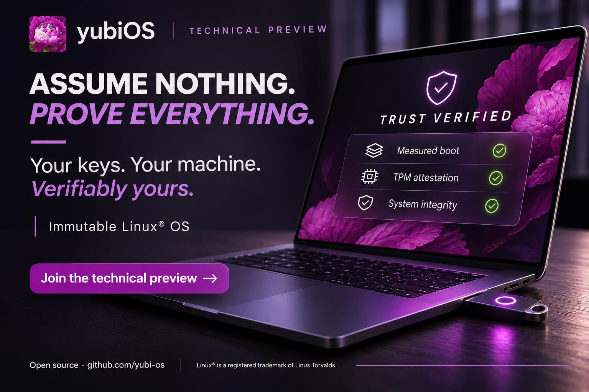

# yubiOS Crowdfunding Campaign Kit (Kickstarter & GoFundMe)

**Assume Nothing. Prove Everything. Your keys. Your machine. Verifiably yours.**

[**Kickstarter Campaign Draft**](KICKSTARTER_CAMPAIGN.md) · [**GoFundMe Campaign Draft**](GOFUNDME_CAMPAIGN.md) · [**Platform Requirements & Flipper One Strategy**](PLATFORM_REQUIREMENTS_AND_STRATEGY.md) · [**Live Hardware Asciinema Demo**](https://asciinema.org/a/y9sHQPQTIbTWNIyr)

---

## Overview

This directory holds the complete crowdfunding package for **yubiOS** (`v0.8.94` Technical Preview), covering both **Kickstarter** (all-or-nothing reward-tier campaign) and **GoFundMe** (flexible-funding community lab-testing campaign).

Both campaigns share one disciplined, two-stage funding structure aimed at **GlobalPlatform Trusted Execution Environment (TEE) Certification** for our ARM64 OP-TEE `4.11` (`fTPM` + `StandaloneMM`) stack:

1. **Campaign 1 (This Launch - $10,000 Goal):** Funds initial third-party accredited security laboratory pre-testing, Target of Evaluation (TOE) scoping, Security Target (ST) authoring against the GlobalPlatform TEE Protection Profile (`TEE PP`, Common Criteria `EAL2+` augmented with `AVA_VAN_AP.3`), and sacrificial hardware fuse/RPMB validation (`OMN-45`, `OMN-46`).
2. **Campaign 2 (Next Phase - ~$100,000 Goal):** Once Phase 1 lab pre-testing passes, a follow-up community campaign (`~$100,000`) funds the official GlobalPlatform Certification Body submission (`$29,000-$36,000` fee schedule) and full 3-month accredited laboratory white-box and black-box vulnerability evaluation. That second phase makes yubiOS the first open-source, community-funded project to pursue GlobalPlatform TEE certification.

### What Contributing Members Receive

- **Early Access to an Assured Node:** Remote access to a dedicated node on yubi-OS infrastructure verified through `yubios-attest` mutual strongbox attestation (combining an OP-TEE `fTPM` PCR `0..7, 11` quote with a hardware U2F/HSM PIV signature), **OR**
- **Pre-Installed Hardware in Hand:** A physical **Radxa ROCK 5B (`rk3588`, 16 GB RAM)** or **Pine64 RockPro64 (`rk3399`, 4 GB RAM)** flashed with the yubiOS immutable OS (`bootc` + `composefs` `verity=require` + 3-way `/usr` OverlayFS + GNOME Wayland + checksum-pinned Antimony v156 browser) and custom TF-A + OP-TEE `4.11` + U-Boot UEFI firmware, ready to bind its full root of trust (`PK`/`KEK`/`db`, LUKS2, `systemd-homed`, resident `ed25519-sk` SSH, and `pam-u2f`) to the backer's own U2F/HSM token on first boot.
- **x86-64 UEFI Setup-Mode Support:** For users running existing x86-64 PCs, laptops, or servers without our ARM64 boards or custom firmware, yubiOS provides UEFI Setup-Mode (`SetupMode=1`) enrollment scripts so owners can sign `systemd-boot` and Type2 UKIs with their own U2F/HSM PIV slot `9a` key (`systemd-sbsign` + PKCS#11) and bind LUKS2 + `systemd-homed` volumes to FIDO2 `hmac-secret`.
- **Pine64 PineTab2 (`rk3566`) Status:** Tracked as an active R&D target (`ci_firmware-rk.yml` builds `:firmware-pinetab2-rk3566`; UART and USB-boot installer validation is under investigation in `OMN-167`). It is presented transparently as under investigation and is not sold as a hardware reward until its non-destructive boot gate passes.

---

## Directory Layout

| Path | Description |
|---|---|
| [`README.md`](README.md) | Master index, asset manifest, and quick-reference table for both campaigns. |
| [`KICKSTARTER_CAMPAIGN.md`](KICKSTARTER_CAMPAIGN.md) | Complete Kickstarter campaign copy, Flipper-One-modeled visual story, spec tables, reward tiers, budget breakdown, roadmap, shipping policy, FAQ, AI disclosure, and Risks & Challenges. |
| [`GOFUNDME_CAMPAIGN.md`](GOFUNDME_CAMPAIGN.md) | Complete GoFundMe campaign copy, required setup fields, donor reward milestones, $10,000 lab budget table, Phase 2 $100k certification horizon, and update templates. |
| [`PLATFORM_REQUIREMENTS_AND_STRATEGY.md`](PLATFORM_REQUIREMENTS_AND_STRATEGY.md) | Field-by-field platform requirements for Kickstarter and GoFundMe, GlobalPlatform TEE fee/evaluation breakdown, and analysis of the Flipper One Kickstarter campaign playbook. |
| [`assets/yubiOS_Technical_Preview.jpg`](assets/yubiOS_Technical_Preview.jpg) | Primary campaign hero image (`https://raw.githubusercontent.com/yubi-OS/assets/main/ads/yubiOS_Technical_Preview.jpg`). |
| [`assets/01-trust-architecture-1360x480.png`](assets/01-trust-architecture-1360x480.png) | Section 1 banner: Two Separate Trust Questions, Two Independent Hardware Domains (U2F/HSM vs. OP-TEE 4.11). |
| [`assets/02-hardware-lineup-1360x560.png`](assets/02-hardware-lineup-1360x560.png) | Section 2 banner: Pre-Installed ARM64 Hardware (ROCK 5B, RockPro64, PineTab2 investigation) + x86-64 Setup Mode. |
| [`assets/03-enrollment-proof-of-life-1360x520.png`](assets/03-enrollment-proof-of-life-1360x520.png) | Section 3 banner: Live Radxa ROCK 5B 5-step hardware enrollment terminal capture (`asciinema.org/a/y9sHQPQTIbTWNIyr`). |
| [`assets/04-globalplatform-tee-certification-1360x520.png`](assets/04-globalplatform-tee-certification-1360x520.png) | Section 4 banner: Two-Stage GlobalPlatform TEE Certification funding model ($10k Phase 1 Lab Pre-Test -> ~$100k Phase 2 Full Certification). |
| [`assets/05-roadmap-to-completion-1360x560.png`](assets/05-roadmap-to-completion-1360x560.png) | Section 5 banner: 4-stage engineering, hardware fulfillment, and GlobalPlatform TEE certification roadmap. |
| [`assets/06-reward-tiers-1360x580.png`](assets/06-reward-tiers-1360x580.png) | Section 6 banner: Visual summary of all 5 contribution tiers ($25 to $749). |
| [`assets/yubios-kickstarter-hero.mp4`](assets/yubios-kickstarter-hero.mp4) | 90.0-second (`1920x1080`, `30 fps`, `yuv420p` TV-range) Kickstarter & GoFundMe hero video with custom `yubios-campaign-score-90s.mp3` (`boot-sound-v5` Strudel progression) + `yubios-boot-sound-v5.mp3` + `yubios-browser-open.mp3`. |
| [`assets/yubios-kickstarter-hero-poster.jpg`](assets/yubios-kickstarter-hero-poster.jpg) | Poster frame (`1920x1080`, baked at frame 0 of `yubios-kickstarter-hero.mp4`). |
| [`assets/yubios-kickstarter-square.mp4`](assets/yubios-kickstarter-square.mp4) | 25.0-second (`1080x1080`, `30 fps`, `yuv420p` TV-range) square social cut for X, LinkedIn, and Hacker News launch seeding with custom `yubios-campaign-score-25s.mp3`. |
| [`assets/yubios-kickstarter-square-poster.jpg`](assets/yubios-kickstarter-square-poster.jpg) | Poster frame (`1080x1080`, baked at frame 0 of `yubios-kickstarter-square.mp4`). |
| [`video/`](video/av-plan.md) | Editable `av-composer` 16:9 90s source (`av-plan.md`, `av-brief.md`, `share-copy.txt`, `composition/index.html`, `composition/audio-manifest.json`). |
| [`video-square/`](video-square/av-plan.md) | Editable `av-composer` 1:1 25s square source (`av-plan.md`, `av-brief.md`, `share-copy.txt`, `composition/index.html`, `composition/audio-manifest.json`). |
| [`source/yubios-campaign-score.strudel`](source/yubios-campaign-score.strudel) & [`source/render_yubios_score.py`](source/render_yubios_score.py) | Custom Strudel score (`Am9 -> Fmaj9 -> G13 -> Cmaj9` / `Dm9 -> Em7 -> Fmaj7#11 -> G13`) and deterministic 44.1 kHz stereo synthesizer. |
| [`source/render_campaign_assets.py`](source/render_campaign_assets.py) | Deterministic SVG-to-PNG renderer using `chrome-headless-shell` and the canonical `logo.png`. |
| [`SHA256SUMS`](SHA256SUMS) | SHA-256 checksums for every rendered PNG, MP4, JPG, HTML, Strudel, and SVG source file. |

---

## Canonical Links Referenced Across Both Campaigns

- **Primary Hero Image:** `https://raw.githubusercontent.com/yubi-OS/assets/main/ads/yubiOS_Technical_Preview.jpg`
- **Live Hardware Asciinema Proof of Life:** `https://asciinema.org/a/y9sHQPQTIbTWNIyr`
- **Raw UART Capture (5-Step Enrollment & Enforcing Secure Boot):** `https://github.com/yubi-OS/yubiOS/blob/main/refs/logs/fvf13-224bf224.new`
- **Raw UART Capture (3-Boot Desktop, GNOME Wayland & Antimony v156):** `https://github.com/yubi-OS/yubiOS/blob/main/refs/logs/fvf14-a76322cd.new`
- **Primary Repository:** `https://github.com/yubi-OS/yubiOS`
- **Technical Preview Quick Start:** `https://github.com/yubi-OS/yubiOS/blob/main/docs/TECHNICAL_PREVIEW.md`
- **Operational Playbook:** `https://github.com/yubi-OS/yubiOS/blob/main/docs/PLAYBOOK.md`
- **Architecture Decision Records (ADR-001..ADR-034):** `https://github.com/yubi-OS/yubiOS/blob/main/docs/ADR.md`

---

## Independence & Trademark Notice

yubiOS is an independent open-source community project. It is not affiliated with, sponsored by, or endorsed by Yubico AB, Radxa, Pine64, or GlobalPlatform, Inc. YubiKey and Yubico are registered trademarks of Yubico AB. Linux® is the registered trademark of Linus Torvalds in the U.S. and other countries.
